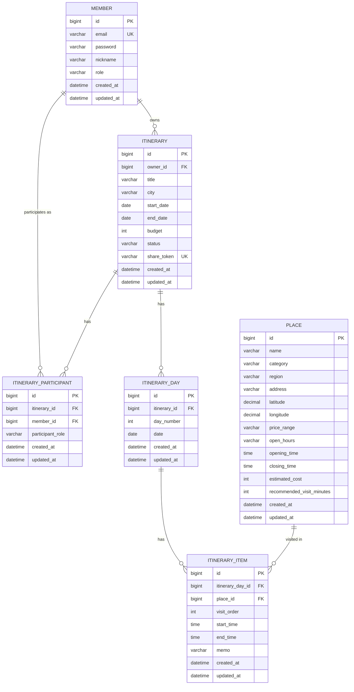

# TravelPlanner — ERD (1~2단계)

> `docs/architecture/TravelPlanner-DB설계.md`의 테이블 정의를 다이어그램으로 표현한 것. 두 문서는 항상 같이 갱신한다
> (컬럼을 바꾸면 DB설계.md와 이 ERD를 동시에 수정). 모든 테이블은 `BaseTimeEntity` 상속으로 `created_at`/`updated_at`을
> 공통으로 가지므로 아래 다이어그램에도 표기했다.

## 관계 요약

| 관계 | 카디널리티 | 비고 |
|---|---|---|
| MEMBER → ITINERARY | 1:N | `itinerary.owner_id`, 일정 소유자 |
| MEMBER → ITINERARY_PARTICIPANT | 1:N | 동행자로 여러 일정에 참여 |
| ITINERARY → ITINERARY_PARTICIPANT | 1:N | 유니크 제약 (itinerary_id, member_id) |
| ITINERARY → ITINERARY_DAY | 1:N | 일정 삭제 시 cascade (정책 문서 2절) |
| ITINERARY_DAY → ITINERARY_ITEM | 1:N | 일자 내 방문 순서(`visit_order`) |
| PLACE → ITINERARY_ITEM | 1:N | 장소는 여러 일정에 재사용될 수 있음 |

## 2~3단계 확장 예정 (지금 반영하지 않음)

- `ITINERARY.version` (낙관적 락) — 3단계 동시 편집 도입 시 추가.
- 실시간/채팅 관련 테이블(메시지, 편집 세션 등) — 3단계 착수 전까지 설계하지 않는다(`TravelPlanner-SA.md` 9절 원칙과 동일).

## 관련 문서

- 테이블 상세/제약/인덱스: `docs/architecture/TravelPlanner-DB설계.md`
- API 계약: `docs/architecture/TravelPlanner-API명세.md`
